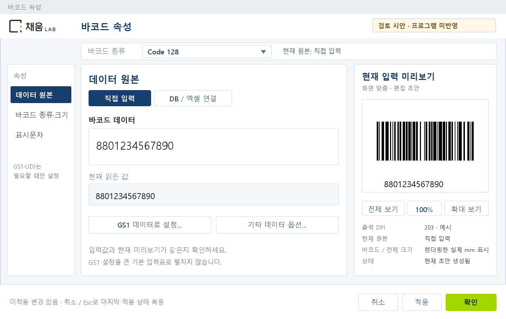
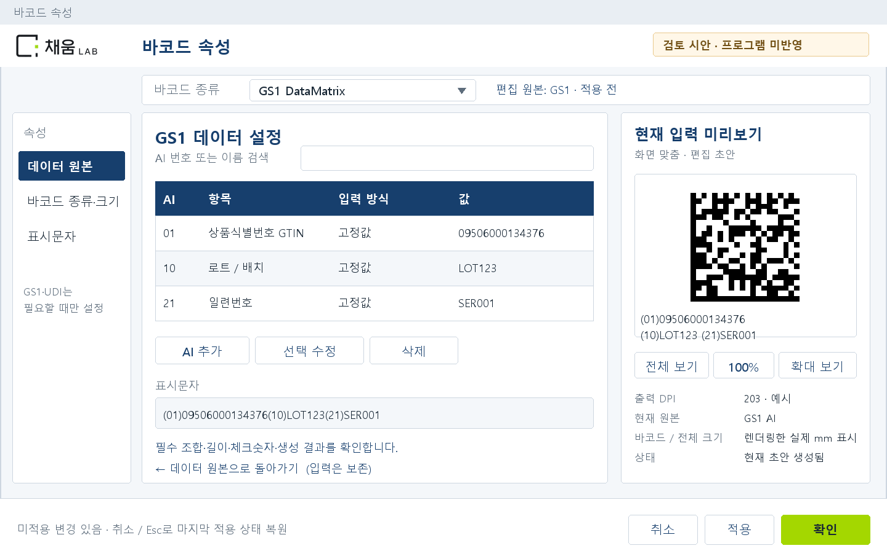
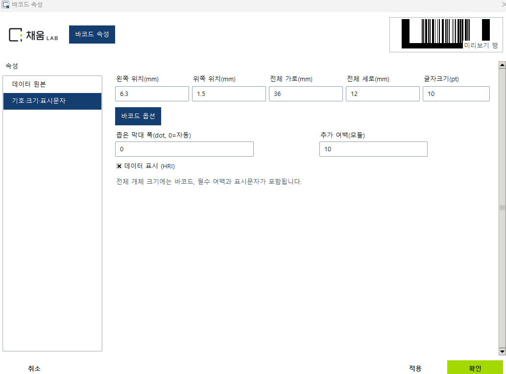

# 채움랩 바코드 편집창 UX 재수정 계획

검토일: 2026-10-13 · 기준: 로컬 릴리스 2026.10.13.03 · 상태: 검토안, 프로그램 미반영

## 1. 판단과 권장안

현재 화면은 데이터 입력보다 크기 설정을 먼저 보여 주고, GS1 설정을 찾는 데 필요한 버튼을 숨깁니다. 작은 미리보기에는 상태 문구가 겹치며, 오류가 나면 구체적인 이유 없이 코드 그림 전체가 사라집니다. 유료 제품의 기본 작업 흐름을 다시 정리해야 합니다.

권장안은 **데이터 원본으로 시작 → 바코드 종류·값 지정 → 오른쪽에서 결과 확인 → 필요한 크기·표시문자만 수정**하는 흐름입니다. GS1은 데이터 원본 화면에서 이름이 보이는 버튼으로 진입하고, UDI는 보조 옵션으로 둡니다.

첨부 화면과 현재 소스, 기존 테스트를 읽어 확인했습니다. 이번에는 앱 실행을 통한 해당 데이터 재현이나 새 제품 테스트를 하지 않았습니다. 보고서·시안만 만들었으며 앱 코드, EXE, 배포 ZIP을 변경하지 않았습니다.

## 2. 확인된 문제

| 우선순위 | 문제 | 확인된 원인 | 사용자에게 미치는 영향 |
| --- | --- | --- | --- |
| P0 | 첫 화면이 크기 설정 | 편집창 마지막 초기화에서 `size` 페이지를 강제로 선택 | 값 입력을 시작하려면 매번 데이터 원본을 다시 눌러야 함 |
| P0 | GS1 설정을 발견하기 어려움 | 크기 페이지의 ‘추가 데이터 옵션’에 숨겨 두고, 일반 기호에서는 버튼 자체를 숨김 | GS1을 설정하려면 먼저 GS1 기호를 골라야 한다는 사실을 사용자가 알아야 함 |
| P0 | 바코드 세부 옵션 버튼도 사라짐 | 버튼의 배치 좌표를 PDF417 보안 수준 입력란으로 잘못 분류 | Code128·GS1-128 등에서 설정 진입 버튼이 숨겨짐 |
| P0 | 미리보기의 설명력이 부족함 | 230×70 영역, 최대 220×60 축소, 이미지 위 상태 문구, 확대·행 선택 없음 | 현재 값, 표시문자, 실제 크기와 오류를 확인하기 어려움 |
| P1 | 오류가 나면 이유 없이 그림이 사라짐 | 엄격한 출력 렌더링 오류를 받고도 오류 내용을 버림 | 잘못된 값인지, DB 미연결인지, 표시문자 공간 부족인지 구분할 수 없음 |

첨부 미리보기의 굵은 검은 외곽부는 기호의 테두리/베어러 바 설정 또는 렌더링 문제일 수 있습니다. 현재 화면에는 기호와 입력값이 없으므로 원인을 확정할 수 없습니다. 다음 수정에서 기호·옵션·값·DPI와 원본 비트맵을 함께 기록해 판별해야 합니다.

## 3. 권장 화면 구조

**왼쪽 메뉴는 세 가지로 정리합니다.**

1. 데이터 원본: 직접 입력, DB/엑셀 연결, 현재 읽은 값, GS1 진입
2. 바코드 종류·크기: 기호, 1D 막대 높이/모듈 폭 또는 2D 가로·세로, 상세 옵션
3. 표시문자: 값 표시 여부, 위치, 글꼴, 크기, 간격

처음 열 때는 새 개체·기존 개체·GS1·UDI 모두 데이터 원본을 선택합니다. 직접 입력이면 값 입력란, DB 연결이면 연결 열에 포커스를 둡니다. 다른 페이지를 보고 닫아도 다음 편집은 데이터 원본에서 시작합니다.

바코드 종류는 작업 영역 상단의 공통 줄에 계속 표시합니다. 어느 페이지에서도 ‘현재 Code128인지 GS1 DataMatrix인지’를 알 수 있게 합니다. 빈 공간을 줄이고 좌측 메뉴보다 데이터 입력과 미리보기 영역에 폭을 배분합니다.

하단의 취소·적용·확인은 고정합니다. 입력 영역만 스크롤하고, 미리보기와 하단 버튼은 함께 밀려나지 않게 합니다. 작은 창에서는 미리보기를 아래쪽으로 재배치하거나 확대 보기를 사용합니다.

## 4. GS1은 쉽게 찾되 선택 기능으로 유지

데이터 원본에 GS1 진입을 직접 표시합니다. 모호한 ‘추가 데이터 옵션’ 메뉴 안에서 찾게 하지 않습니다. 일반 바코드에서는 **‘GS1 데이터로 설정…’**, 이미 GS1 구성인 경우 **‘GS1 데이터 수정…’**으로 현재 작업을 설명합니다.

- 일반 코드에서 버튼을 누르면 같은 편집창 안에서 GS1-128/GS1 DataMatrix 등을 선택하고 AI 구성을 시작합니다. 다른 페이지로 돌아가 기호를 먼저 선택하라고 요구하지 않습니다.
- 기존 GS1 개체를 열면 ‘현재 원본: GS1 · AI 항목 3개’와 수정 버튼을 첫 화면에 표시합니다.
- AI 화면은 `AI / 항목 / 값 입력 방식 / 값`으로 정리하고, 검색·추가·수정·삭제·순서 변경을 제공합니다. 표시문자와 인코딩 데이터는 구분해 보여 줍니다.
- ‘GS1 데이터로 설정…’에서 기호를 선택하면 편집 초안의 원본을 GS1로 지정합니다. 별도의 출력 원본 체크박스와 하위 창 적용 버튼을 제거하고, 편집창의 적용/확인 한 곳에서 검증·저장합니다. ‘데이터 원본으로 돌아가기’는 초안의 요약 화면만 보여 줍니다. ‘일반 데이터로 전환’은 원본 변경이므로 별도 동작으로 구분합니다.
- 설정 내용을 둘러보거나 취소하면 저장된 원본과 입력값을 유지합니다. 일반 데이터로 돌아갈 때도 같은 편집창의 초안을 보관하고 전환 결과를 보여 줍니다. 아직 저장되지 않은 원본은 ‘편집 원본: GS1 · 적용 전’으로 표시합니다.
- UDI는 ‘기타 데이터 옵션… → 의료기기 UDI’로 진입합니다. 기본 화면에는 DI/PI·시장·포장 등의 큰 입력표를 펼치지 않습니다.

BarTender 2022 공식 도움말은 데이터 원본, 기호·크기, 표시문자 속성을 분리하며 GS1-128 페이지에 이름이 명확한 AI 마법사를 제공합니다. 이 익숙한 분류를 참고하되, 데이터 원본을 첫 화면으로 여는 것은 이번 사용자 요구에 맞춘 결정입니다.

## 5. 미리보기 수정 기준

미리보기는 헤더의 작은 썸네일에서 **오른쪽 고정 패널**로 옮깁니다. 일반 창에서 약 320~360px 폭과 260px 이상 이미지 높이를 확보하고, 실제 사용 가능한 화면 크기에 맞춰 조정합니다. 화면 맞춤은 전체 배치를 확인하는 용도이고, 100%/모듈 확대는 세부 모양을 확인하는 용도입니다.

| 표시 항목 | 동작 기준 |
| --- | --- |
| 현재 입력 결과 | 고정값·DB 열·AI·크기·표시문자를 바꾸면 적용 전 초안으로 갱신 |
| 데이터 확인 | 원본 입력, 실제 인코딩 값, 표시문자를 별도 행으로 표시. 긴 값은 복사·확대 확인 가능 |
| DB 연결 | ‘현재 행 1 / 50’과 열 이름·실제 값을 표시. 이전/다음 행으로 확인 가능 |
| 크기와 DPI | 바코드 실제 mm, 문자 포함 전체 mm, 모듈 도트, 출력 DPI 표시 |
| 화면 확대 | 원래 비율을 유지. 원본 출력 도트와 확대 화면을 구분하고, 세부 확대는 픽셀 경계를 보존 |
| 상태 문구 | 이미지 바깥의 별도 영역에 표시. ‘미리보기 행’처럼 정보 없는 문구 제거 |
| 입력값 오류 | 문제 필드·실제 원인·다음 조치를 표시. 이전 정상 그림을 현재 결과처럼 남기지 않음 |
| 표시문자/경계 오류 | 유효하게 생성 가능한 코드 그림을 유지하고 인쇄 불가 이유를 표시. 데이터는 삭제·축소하지 않음 |

메인 라벨 캔버스와 편집창이 같은 초안·렌더 결과·오류 원인을 사용하도록 맞춥니다. 이미지가 존재한다는 이유로 성공 처리하지 않고, 실제 입력값과 그림의 값이 같은지 확인합니다. 화면 미리보기만으로 실제 인쇄품질 등급이나 실물 판독을 보증하지 않습니다.

## 6. 구현 순서와 완료 조건

1. **첫 페이지·메뉴 노출 수정:** 데이터 원본 기본 선택, 바코드 상세 옵션 버튼과 옵션 필드의 명시적 구분, GS1 직접 진입 버튼.
2. **미리보기 통합:** 고정 패널, 행·DPI·mm·원문 표시, 오류 원인, 확대, 초안 갱신. 메뉴별로 다른 렌더 오류 처리 해소.
3. **GS1 흐름 단축:** 같은 창에서 기호 선택과 AI 구성, 전역 적용/확인 한 번으로 저장, 전환 시 값 보존. UDI 보조 옵션 유지.
4. **실제 사용자 경로 검증:** 화면의 버튼을 눌러 재현하고 정상·잘못된 값·공간 부족·DB 미연결을 확인. 고객 EXE 화면을 직접 검수.
5. **승인 후 문서·배포 갱신:** 최종 UI 화면으로 매뉴얼을 바꾸고 테스트·빌드·파일 해시·고객 ZIP을 확인.

| 검증 시나리오 | 합격 기준 |
| --- | --- |
| 새/기존/GS1/UDI 개체 더블클릭 | 데이터 원본이 처음 보이고 알맞은 입력에 포커스 |
| 일반 Code128에서 GS1 설정 찾기 | 첫 화면에서 한 번 클릭해 구성 진입, 숨은 선행 설정 없음 |
| Code128·GS1-128·GS1 DataMatrix·QR 상세 옵션 | 설정 버튼이 항상 보이며 해당 기호의 지원 옵션만 표시 |
| 고정값/DB/AI/크기/표시문자 변경 | 적용 전 현재 초안으로 갱신. 이전 행·이전 데이터가 남지 않음 |
| 입력·체크숫자·DB 연결 오류 | 정확한 필드와 원인 표시, 값 보존, 저장 실패를 설명 |
| 표시문자 공간·라벨 경계 오류 | 가능한 코드 그림 유지, 수정 방법 표시, 출력 차단 |
| 취소·X·Esc / 적용 후 재편집 | 마지막 적용 상태를 정확히 보존하며 항상 닫힘 |
| 203/300/600 DPI 및 100/125/150/200% 배율 | 미리보기·상태·전체 값·하단 버튼 겹침/잘림 없음 |

정상 코드의 원본 비트맵은 별도 디코더로 값과 GS1 식별자를 확인하고, 편집창 미리보기·메인 캔버스·인쇄파일이 같은 값과 도트 크기를 쓰는지 비교합니다. 갱신 응답은 입력 후 0.5초 이내를 목표로 측정하되, 실제 측정 전에는 성능 개선 완료라고 보고하지 않습니다.

## 7. 기존 검증에서 보완할 부분

이전 6,855개 테스트 통과는 당시 자동 검증 결과입니다. 이번 사용자 화면이 적합하다는 증거로 사용하기에는 다음 검사가 빠져 있습니다.

- AI/UDI 테스트는 내부 페이지 선택과 메뉴 직접 호출을 사용해 실제 버튼 발견 가능성을 확인하지 않습니다.
- 크기 UI 검사는 일부 컨트롤 범위를 확인하지만 첫 페이지와 미리보기 문구 겹침을 검사하지 않습니다.
- 코드 유지 미리보기 테스트는 메인 캔버스 경로를 검사하고, 편집창 헤더 경로는 검사하지 않습니다.
- 별도 세부 옵션 팝업 미리보기 테스트는 바코드 속성창 미리보기 품질을 대신할 수 없습니다.

수정 후에는 기호별 일반 사용 흐름을 실제 UI에서 수행하고, 현재 값·표시문자·GS1 버튼·미리보기 상태가 보이는 화면 증거를 남겨야 합니다.

## 8. 코드 근거와 참고 자료

소스: `barcode_label_automation/label_designer_app.py`

- 5454~5456: 미리보기 230×70 영역
- 5500~5501: 이미지 영역과 겹치는 상태 문구 배치
- 5736~5743: 상세 옵션과 GS1/UDI 메뉴 생성
- 5765~5784: 썸네일 축소·엄격한 렌더·오류 내용 미표시
- 5833~5842, 5914~5922: 좌표 기반 옵션 분류와 GS1/상세 옵션 숨김
- 6301~6305: 진입한 뒤에야 생기는 추가 데이터 옵션 메뉴
- 6322~6323: 크기 페이지 기본 선택
- 4469~4483: 메인 2D 미리보기의 코드 유지 경로

기존 테스트: `test_ai_udi_workflow_ui.py` 16~23, 119~129 / `test_barcode_first_ui.py` 358~369 / `test_barcode_dialogs.py` 195~208.

공식 참고:

1. [BarTender 2022 Barcode Properties](https://help.seagullscientific.com/2022/en/Content/Objects_BarcodePropertiesDialog.htm)
2. [BarTender 2022 데이터 원본](https://help.seagullscientific.com/2022/en/Content/Overview_of_Data_Sources.htm)
3. [BarTender 2022 GS1-128과 AI 설정 진입](https://help.seagullscientific.com/2022/en/Content/symb_GS1_128.htm)

본 문서의 제안 화면은 검토용 시안입니다. 실제 프로그램에 구현된 화면으로 오해하지 않도록 각 이미지에 표시했습니다. 승인 후 위 순서로 구현·검증·문서·배포를 진행하는 범위입니다.
